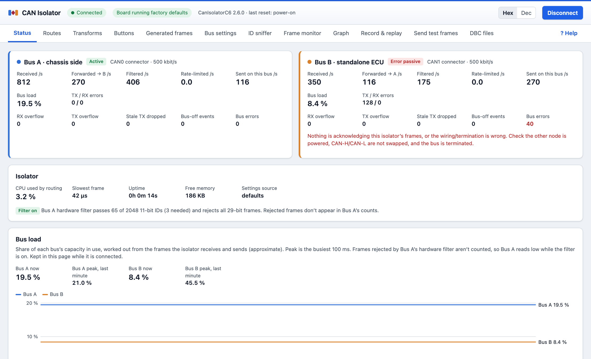
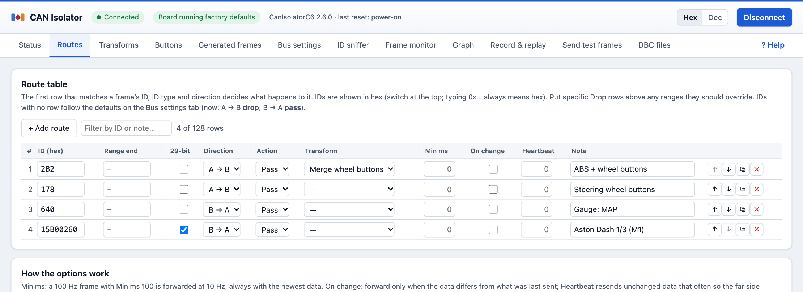
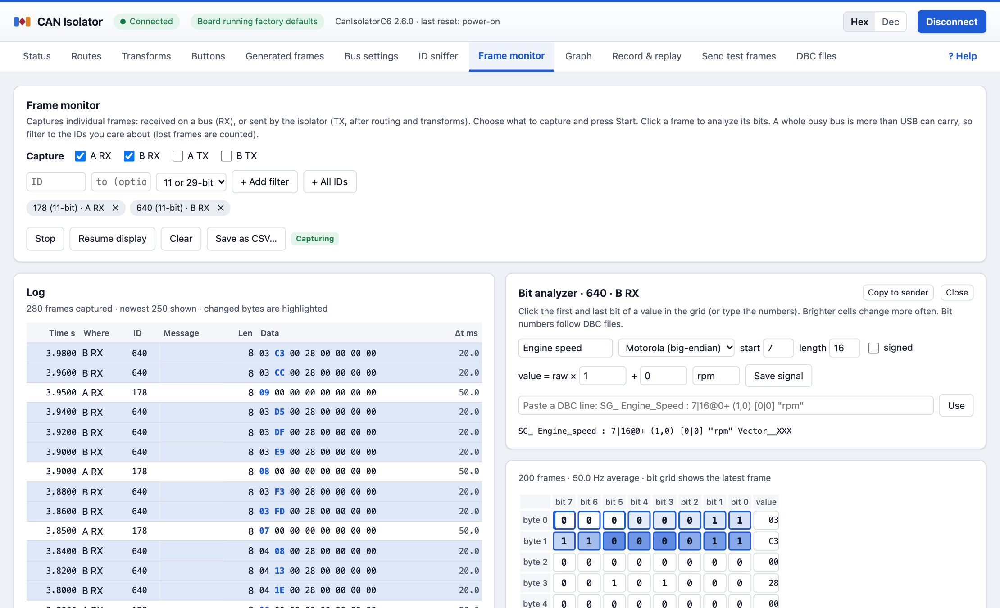
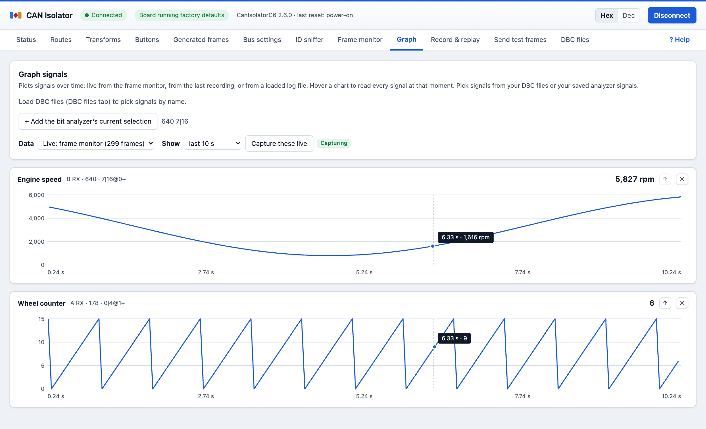
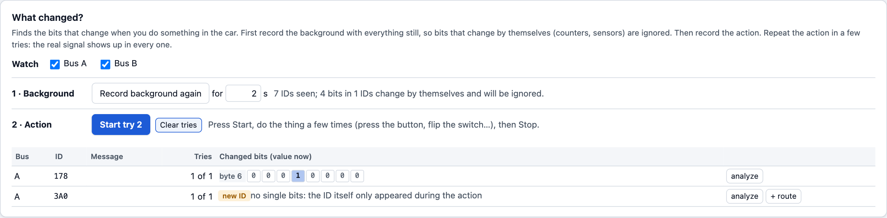
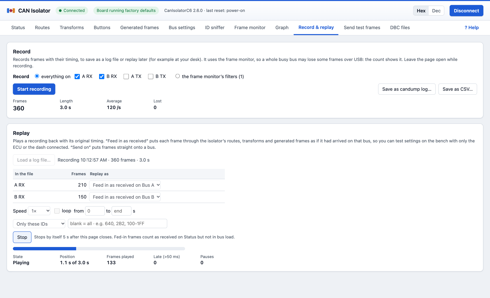
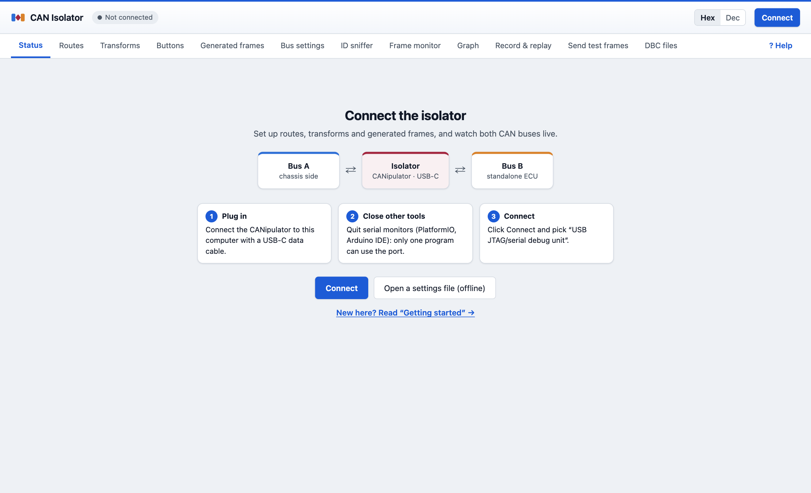
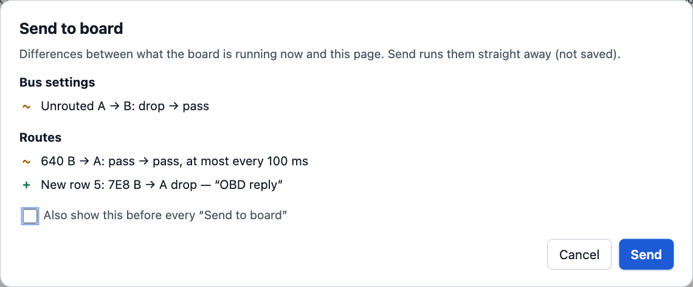

<p align="center">
  
</p>

<h1 align="center">CAN Isolator</h1>

<p align="center">
  <b>A two-bus CAN gateway for cars running a standalone ECU.</b><br>
  It decides, frame by frame, what crosses between the chassis bus and the ECU bus.<br>
  Set it up and watch it live from a web page over USB, with nothing to install.
</p>

<p align="center">
  
  
  
  
</p>

<p align="center">
  <picture>
    <source media="(prefers-color-scheme: dark)" srcset="docs/images/banner-dark.svg">
    
  </picture>
</p>

---

## Why

A standalone ECU dropped into a production car often shares a CAN bus with ABS, steering wheel, dash and body modules. Their traffic can overload the ECU's receive and transmit queues, and the car's modules may expect frames the ECU doesn't send.

The isolator splits the network in two:
- Only the IDs you whitelist reach the ECU, optionally rate-limited or rewritten on the way.
- The ECU's output goes back to the chassis side as before.
- The isolator can build frames the car expects (dash, cluster) from data it already sees.

## Features

| Feature | What it does |
|---|---|
| 🔀 **Routes** | First-match route table (up to 128 rows): pass or drop by ID or range, per direction, with rate limit, on-change + heartbeat, and a transform. Unrouted A → B traffic is dropped by default (a whitelist). |
| 🛠 **Transforms** | Rewrite frames in flight: change the ID or length, set or clear bits, copy scaled or masked fields from this or another frame (e.g. merge steering-wheel buttons into the ABS frame, catching short presses), add rolling counters, or forward only if a condition holds. A "Try it" panel uses the firmware's own math. |
| ⏱ **Generated frames** | Up to 8 frames the isolator builds on a timer from cached source data (scale, offset, counters, checksums/CRC-8), e.g. dash frames the ECU can't produce. They stop automatically when their source goes stale. |
| #️⃣ **Checksums** | Sum, XOR, nibble and CRC-8 checksums (with presets such as SAE J1850 and AUTOSAR) for modules that reject frames without a valid one. |
| 📄 **DBC export** | Writes a `.dbc` of exactly what the isolator sends on a bus — merged bytes keep their signal names, rescaled copies their units — ready to import into the ECU software. |
| 🛡 **Hardware filter** | Bus A's CAN controller rejects frames nothing needs, so a flooded chassis bus costs no CPU. |
| 🔍 **Find signals** | ID sniffer, frame monitor with a bit analyzer, and **What changed?**, which finds the bit behind a button or switch by comparing a "background" capture with the action. |
| 📈 **Graph** | Plot DBC or hand-defined signals over time, live or from a recording, with a crosshair synced across charts. |
| ⏺ **Record & replay** | Record a drive and save it as a candump log or CSV. Replay it (or a SavvyCAN / Vector log) *into* the isolator to test settings at your desk, or onto a bus. |
| 🩺 **Health** | Per-bus load and peak, error counters, and an event history of bus trouble kept on the isolator, so you can read it after a drive. |
| ✅ **Safe changes** | Send runs edits in RAM only. Save shows exactly what changes before writing to flash. Firmware updates from the page roll back by themselves if the new version doesn't start properly. |

## Screenshots

<table>
  <tr>
    <td width="50%"><br><sub><b>Status:</b> both buses at a glance, bus load, event history</sub></td>
    <td width="50%"><br><sub><b>Routes:</b> first match wins; pass, drop, rate-limit, transform</sub></td>
  </tr>
  <tr>
    <td><br><sub><b>Frame monitor + bit analyzer:</b> decode any bits, live</sub></td>
    <td><br><sub><b>Graph:</b> signals over time with a synced crosshair</sub></td>
  </tr>
  <tr>
    <td><br><sub><b>What changed?:</b> the button's bit, found in one try</sub></td>
    <td><br><sub><b>Record & replay:</b> bench-test with a recorded drive</sub></td>
  </tr>
</table>

## Quick start

**You need:**
- a TechOverflow CANipulator (ESP32-C6, two CAN transceivers)
- a USB-C data cable
- Chrome or Edge on a Mac, Windows or Linux computer

1. **Flash the firmware once** with [PlatformIO](https://platformio.org/). This also installs the partition table with the update slot and the settings area:
   ```sh
   cd CanIsolatorC6
   pio run -t upload
   ```
   Later updates are done from the config tool (**More… → Update firmware…**, then pick `Firmware/CanIsolatorC6-<version>.bin`).
2. **Open the config tool:** double-click `ConfigTool/Open Config Tool.command` (Mac) or `ConfigTool/Open Config Tool.bat` (Windows), or open `ConfigTool/index.html` in Chrome or Edge.
3. **Connect:** click **Connect** and pick *USB JTAG/serial debug unit* (on Windows, *USB Serial Device (COM…)*).

   

4. **Wire it in:**
   - Bus A goes to the chassis side and Bus B to the ECU.
   - Bus B usually needs the board's 120 Ω termination jumper bridged.
   - The Status tab should show both buses *Active*.

> [!TIP]
> Press <kbd>?</kbd> on any tab for help about that tab. The complete help is also in **[docs/USER-GUIDE.md](docs/USER-GUIDE.md)**.

## Using it: the essentials

<details>
<summary><b>How a frame is handled</b></summary>

For every frame received, the isolator decides in this order:

1. **Generated copy?** If the isolator builds a frame with this ID itself and it arrives on the *other* bus, it is dropped, so receivers never see two sources.
2. **First matching route:** the table is read top to bottom. The first row whose ID (or range), 11/29-bit type and direction match decides: drop, or pass (optionally rate-limited, on-change, or through a transform).
3. **Default:** unrouted A → B is dropped (whitelist); unrouted B → A passes.

Frames that can't be sent within the *TX max age* (50 ms) are discarded rather than sent late.
</details>

<details>
<summary><b>Let a new chassis-side ID through to the ECU</b></summary>

1. **ID sniffer** → Start, and find the ID on Bus A. It shows *Default: drop*.
2. Click **+ route**. On **Routes**, add a note, and a *Min ms* if the ECU doesn't need every frame.
3. **Send to board**, check the sniffer now says *Row n: pass*, then **Save to board**.
</details>

<details>
<summary><b>Find which bit a button sets</b></summary>

1. **ID sniffer → What changed?** → *Record background* with nothing touched (10 s).
2. **Start**, press the button a few times, **Stop**. Do two or three tries.
3. The bit that appears in every try is the one. Click **analyze** to open it in the bit analyzer, name it, and **Save signal**.
</details>

<details>
<summary><b>Merge steering-wheel buttons into another frame</b></summary>

1. **Transforms → + Merge bytes from another frame.**
2. Set the source to the wheel frame (Bus A, its ID) and pick which wheel byte goes into which byte, one copy step per byte. *If missing or stale: write 0* makes the buttons read “released” when the wheel goes quiet. Tick *catch short presses* for bytes where each bit is one button.
3. On **Routes**, pick the transform in the Transform column of the frame that should carry the buttons (e.g. the ABS frame), then **Send** and **Save**.

Settings from before firmware 2.7 used a separate Buttons tab; **Transforms → Convert to a transform** turns it into exactly this.
</details>

<details>
<summary><b>Build a frame the ECU used to send (or never could)</b></summary>

1. Load the ECU's DBC on the **DBC files** tab.
2. **Generated frames → + Add generated frame**: ID, bus, period, constant bytes.
3. **+ Field from a frame** → pick the source by DBC signal name. *Work it out from units…* sets the scaling. Pick the destination bits in the grid.
4. Check the preview, turn it **On**, **Send**. On Status, compare it with the ECU's own copy if there is one, then **Save**.
</details>

<details>
<summary><b>Make a module accept a frame with a checksum</b></summary>

1. Capture the module's frames in the **Frame monitor**. The bit analyzer's *Worth a look* spots the rolling counter, and the checksum is the byte that changes with everything else.
2. Add a **Checksum / CRC** step to a transform (or a checksum field to a generated frame) and try the presets (sum, two's complement, XOR, nibble sum, CRC-8 SAE J1850 / AUTOSAR) in **Try it** with captured frames until the result matches the real byte.
3. Keep the checksum after any counter, **Send**, check the module accepts the frame, then **Save**.
</details>

<details>
<summary><b>Set up the ECU to receive what the isolator sends</b></summary>

1. Load the DBC files for your chassis devices (wheel, ABS…) on the **DBC files** tab, so their signals have names.
2. **DBC files → Export a DBC of what the isolator sends → Bus B (to the ECU) → Download .dbc.**
3. Import it in the ECU software. Merged bytes (e.g. wheel buttons inside the ABS frame) appear under their own names at their new position, and rescaled copies keep their units.
</details>

<details>
<summary><b>Test settings at your desk with a recorded drive</b></summary>

1. In the car: **Record & replay** → record A RX (and B RX) → **Save as candump log**.
2. At the desk, with only the ECU or dash connected: load the log, set A RX to *Feed in as received on Bus A*, **Start replay**.
3. Watch the result in the **Frame monitor** (B TX) or the **Graph** tab, adjust, Send, and replay again.
</details>

<details>
<summary><b>Change settings safely</b></summary>

- **Send to board** runs edits in RAM only: a power cycle goes back to the saved settings.
- **Save to board** lists every difference from what's saved before writing to flash.

  

- **More… → Board: go back to saved settings** undoes unsaved changes instantly.
- **No computer?** Hold BOOT for 3 s while running to erase the saved settings and restart on the defaults. Don't hold BOOT at power-up: that enters flashing mode.
- Back up with **More… → Export settings** (routes, transforms, generated frames and saved signals).
</details>

<details>
<summary><b>Read the status LED</b></summary>

| LED | Meaning |
|---|---|
| 🟢 Green | Frames received on both buses |
| 🔵 Blue | Frames received on one bus only |
| 🔴 Red | A bus went error-passive or bus-off in the last half second |
| ⚫ Off | No traffic on either bus |
| 🟣 Magenta | The CAN driver failed to start |
| ⚪ Flashing white | BOOT held 3 s: factory reset in progress |
</details>

More recipes, every tab explained, bit numbering (Motorola vs Intel), troubleshooting and a glossary: **[User guide](docs/USER-GUIDE.md)**.

> [!WARNING]
> The isolator sits between the ECU and the rest of the car. A wrong route, transform or generated frame can stop data that the ECU, dash or chassis systems rely on. Test with **Send to board** on the bench or with the car stationary before saving. Test and replayed frames sent onto a bus are real traffic.

## Performance

Measured on the bench with firmware 2.8.0:

| Measure | Result |
|---|---|
| Forwarding latency | 0.1–0.2 ms typical, ≤ 1.5 ms while the page is monitoring |
| CPU | ~7 % at 700 frames/s; unneeded chassis frames cost 0 % with the hardware filter |
| Replay timing | within 0.1 ms of the recording; 1,000 frames/s streamed with none late |
| Firmware update over USB | ~40 KB/s, about 10 s, automatic rollback |

## Repository layout

| Folder | What it is |
|---|---|
| [`CanIsolatorC6/`](CanIsolatorC6) | Firmware (PlatformIO, Arduino-ESP32 4.x). The USB protocol is documented at `handleCommand()`. |
| [`ConfigTool/`](ConfigTool) | The browser config tool: one self-contained `index.html` using Web Serial, plus Mac and Windows launchers. |
| [`Firmware/`](Firmware) | Prebuilt app images for **More… → Update firmware**. Every build copies its image here. |
| [`docs/`](docs) | [User guide](docs/USER-GUIDE.md) (generated from the in-page help), [roadmap](docs/ROADMAP.md) and images. |
| [`tools/`](tools) | `export-guide.js` regenerates the user guide from the page. |
| [`CanipulatorTest/`](CanipulatorTest) | Bring-up test firmware for the board: self test, pin test, cross test, listen-only monitor. |

### Building

```sh
cd CanIsolatorC6
pio run            # build; the image is copied to ../Firmware/CanIsolatorC6-<version>.bin
pio run -t upload  # flash over USB
```

### Updating the user guide

The in-page help in `ConfigTool/index.html` is the source. After editing it:

```sh
npm install playwright-core   # once; uses your installed Chrome
node tools/export-guide.js    # rewrites docs/USER-GUIDE.md
```

### Older hardware

Only the CANipulator (ESP32-C6) is supported. The earlier Teensy 4.0 version is deprecated and preserved at the tag [`teensy-final`](../../tree/teensy-final).

## Roadmap

Features under consideration, including a Bluetooth LE connection for monitoring without USB, are in [docs/ROADMAP.md](docs/ROADMAP.md).

## License

[GPL-3.0](LICENSE)
